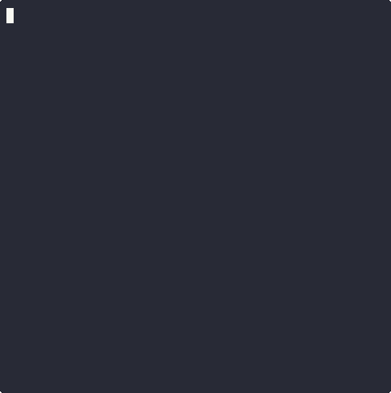

# *yafth* - Yet Another Fallout Terminal Hacking ~~Game~~

> Patrolling the Mojave almost makes you wish for a nuclear winter.

A C++17 terminal hacking game and an example of
[yafth.h](https://github.com/gshigin/yafth.h) with [FTXUI](https://github.com/ArthurSonzogni/FTXUI).

## Demo

  

## Installation

Requires CMake 3.14 or later and a C++17 toolchain.

~~~sh
git clone https://github.com/gshigin/yet-another-fallout-terminal-hacking-game.git yafth
cd yafth
cmake -S . -B build
cmake --build build
~~~

## Usage

~~~text
Usage: yafth [options]
  -h, --help             Show this help message
  -s, --science VALUE    Science skill (0-100)
  -l, --lock VALUE       Difficulty (0-4 or very_easy, easy, average, hard, very_hard)
  --seed VALUE           Unsigned 64-bit seed
Use the mouse to select entries; Escape or q exits.
~~~

The defaults are Science 50, Average difficulty, and a seed based on the
current time. If you supply only Science, the game picks the hardest
accessible difficulty. If you supply only a difficulty, it uses the minimum
Science required.

~~~text
$ yafth --science 50 --lock very_hard
Error: insufficient Science for the selected difficulty
~~~

Hover to highlight an entry and release the left mouse button to select it.
A word guess can spend an attempt. Bracket pairs can remove a dud or restore
attempts.

## Dependencies

- [yafth.h 1.0.0](https://github.com/gshigin/yafth.h/tree/3273bba)
- [FTXUI 7.0.3](https://github.com/ArthurSonzogni/FTXUI/releases/tag/v7.0.3)

## License

The example is under the MIT License. See [LICENSE](LICENSE).
The vendored [yafth.h](yafth.h) is available under MIT or The Unlicense.
FTXUI is under MIT.
